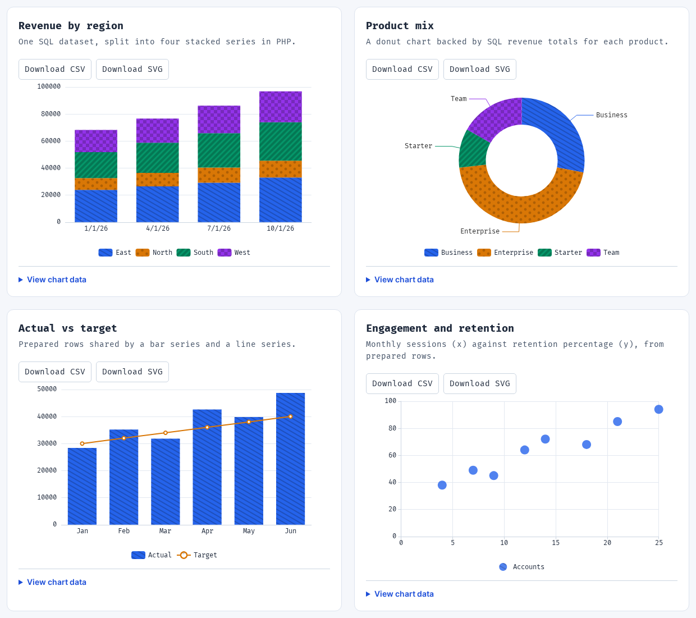
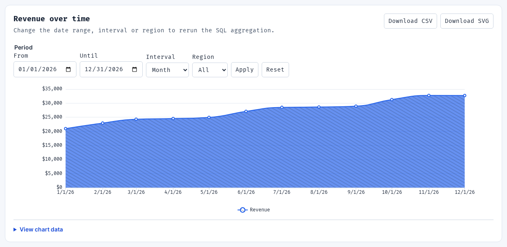
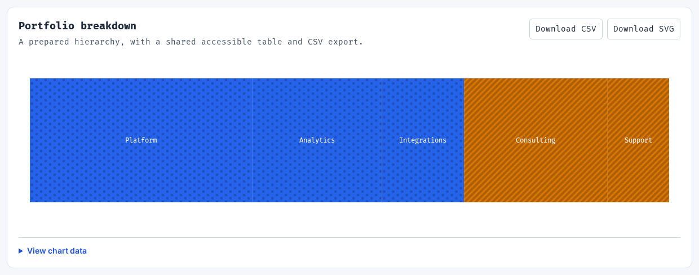
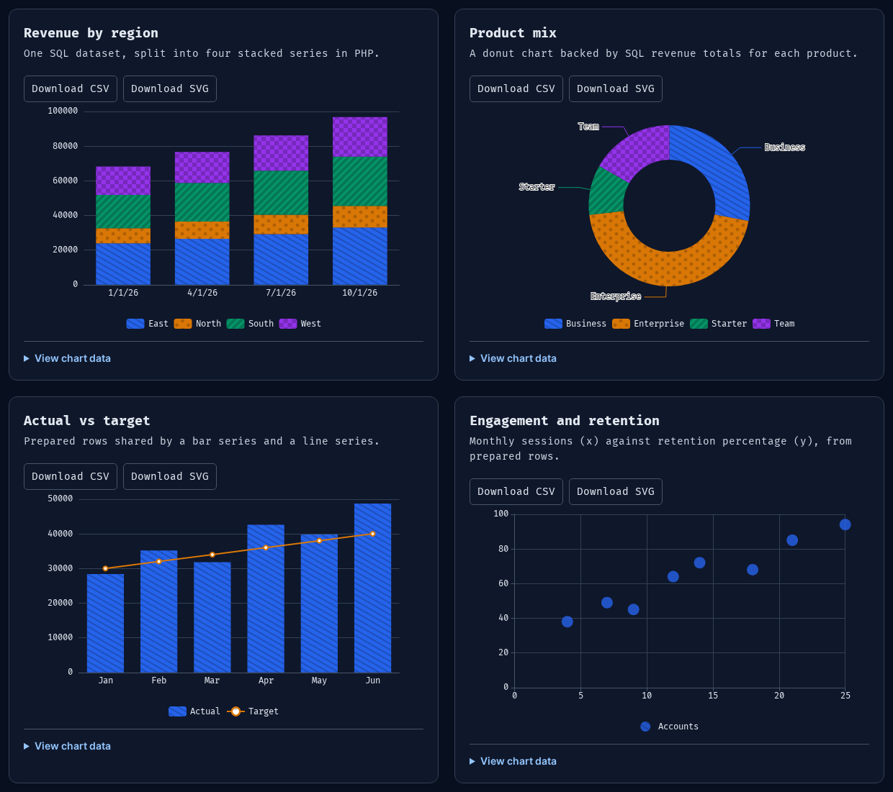

# Chart Builder

Define charts in PHP and render them in Laravel applications using Inertia and React. Ships with ECharts, prepared and SQL-backed datasets, filters, accessible data tables, CSV/image downloads, and a public adapter SDK.



Actual browser captures from the [PHP demo definitions](examples/charts.php), rendered by the package's React component and included ECharts adapter using deterministic sample data.

<details>
<summary>See the built-in filters, treemap, and dark theme</summary>

Date range, interval, and region filters on a SQL-backed revenue chart:



A treemap generated from a prepared hierarchy:



The same four charts in dark mode:



</details>

The initial release is `0.1.0`; see the [release notes](CHANGELOG.md). Requires PHP 8.5, Laravel 13, React 18 or 19, and Inertia 2 (React 18/19) or 3 (React 19). The default adapter uses ECharts 6. Package and SDK releases must be published before registry installation; [local installation](docs/consumers/getting-started.md) works from this checkout.

```php
use Wtroiano\ChartBuilder\ChartBuilder;
use Wtroiano\ChartBuilder\Datasets\Dataset;
use Wtroiano\ChartBuilder\Series\LineSeries;

$chart = ChartBuilder::make('revenue')
    ->title('Monthly revenue')
    ->data(Dataset::rows([
        ['id' => 'jan', 'month' => 'Jan', 'revenue' => 12500],
        ['id' => 'feb', 'month' => 'Feb', 'revenue' => 14800],
    ])->key('id'))
    ->xAxis('month')
    ->series([LineSeries::make('revenue')->value('revenue')->currency('USD')])
    ->build();

return Inertia\Inertia::render('reports', [
    'revenueChart' => $chart->result(request()),
]);
```

```tsx
import { Chart, type ChartResult } from "@/vendor/chart-builder";

export default function Reports({ revenueChart }: { revenueChart: ChartResult }) {
    return <Chart name="revenue" propName="revenueChart" result={revenueChart} />;
}
```

Charts require an authenticated user by default. Define an authorization callback for application policies and scope the data source to the current tenant. Use `public()` only for intentionally public data.

[Getting started](docs/consumers/getting-started.md) · [Documentation](docs/README.md) · [Adapters](docs/consumers/adapters.md) · [Contributing](CONTRIBUTING.md) · [License](LICENSE)

Run `npm run dev` after `composer install` and `npm ci`, then open `http://127.0.0.1:4174/demo` for six live PHP-generated charts. Change filters to rerun SQL aggregation, switch themes, inspect accessible data, or download CSV/SVG. Edit `examples/charts.php` to try your own definitions; the preview reloads on PHP changes. It uses deterministic sample data in an isolated in-memory SQLite database. The 36-example renderer gallery is at `/gallery`, and transport test scenarios are at `/charts`.
