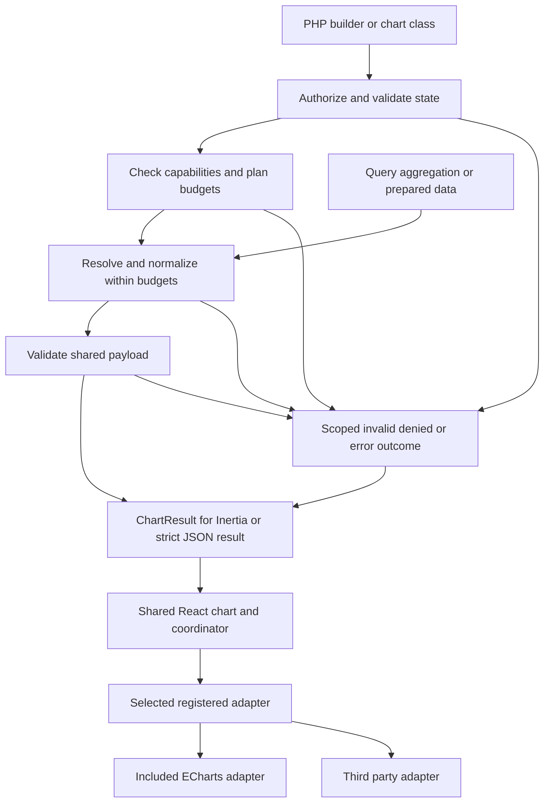

# Chart Builder Package Specification

Chart Builder gives Laravel applications a fluent PHP API for defining charts, preparing data, and rendering through React and Inertia. Rendering adapters connect a shared chart contract to different charting libraries. ECharts is the included default adapter. SQL aggregation and prepared datasets are equally supported inputs.

Release 0.1.0 specification. A public adapter contract and SDK, ECharts as the included default, broad chart coverage, built-in aggregation, and prepared data support are the implemented direction. Package versions begin at 0.1.0; adapter API and payload schema versions remain 1.

# Package identity and installation

| Item | Proposed contract |
| --- | --- |
| Composer package | `wtroiano/chart-builder` |
| PHP namespace | `Wtroiano\ChartBuilder` |
| Runtime | PHP 8.5 and Laravel 13, matching Table Builder |
| React compatibility | React 18 with Inertia 2; React 19 with Inertia 2 or 3 |
| Included adapter | ECharts 6, with the supported minor range recorded and tested at release |
| Adapter SDK | `@wtroiano/chart-builder-sdk` 0.1.x: public types, JSON Schemas, validators, and shared helpers |
| Adapter API | Public version 1 contract and capability manifest for independently distributed adapters |
| Distribution | Composer package containing publishable React sources and the included ECharts adapter, plus an independently versioned npm SDK |
| Styling | Scoped CSS, CSS variables, system fonts, light and dark themes |
| License | MIT for package code; retain upstream notices for distributed dependencies |

The PHP core depends on the relevant Illuminate components. Inertia is supplied by the application and is optional for plain JSON use. The shared React core depends on the public SDK and has no chart-engine dependency. The SDK has no Inertia or engine imports; React is a peer dependency with type-only imports in its contracts. The included adapter wraps ECharts directly without an additional React chart wrapper. Table Builder, Metrics, Tailwind, and a UI framework are optional application integrations.

```bash
composer require wtroiano/chart-builder
php artisan vendor:publish --tag=chart-builder-react
npm install @wtroiano/chart-builder-sdk@^0.1.0 echarts@~6.1.0
npm run build
```

The optional `chart-builder-react-page` tag publishes a standalone page. `make:chart RevenueChart` scaffolds a reusable definition. Published assets live in `resources/js/vendor/chart-builder`; updates preserve application edits unless the application explicitly republishes with force. The default `chart-builder-react` tag publishes the shared core, the ECharts adapter, and a convenience entry point that registers it. `chart-builder-react-core` publishes only the shared sources and their entry point for applications supplying another adapter; `chart-builder-echarts` publishes the ECharts adapter separately. Core-only consumers install the SDK and their chosen adapter and engine dependencies. Publishing UI sources does not copy or fork the SDK contracts.

The initial version targets the same stack as Table Builder. Supporting older Laravel or PHP versions requires an additional dependency and CI matrix before those versions are advertised.

# Chart coverage

The included ECharts adapter must ship a working example and rendering test for every series family in the coverage table. This broad coverage is a 0.1.0 release criterion. Each third-party adapter declares its own supported subset and additional features; using the common PHP API does not imply feature parity across engines.

| Family | Included ECharts adapter coverage |
| --- | --- |
| Cartesian | Line, area, step line, bar, horizontal bar, stacked and grouped variants, scatter, bubble, effect scatter |
| Proportion and indicators | Pie, donut, rose, funnel, gauge, radar |
| Statistical and financial | Heatmap, boxplot, candlestick, parallel coordinates |
| Hierarchical | Tree, treemap, sunburst |
| Relationships and flows | Graph, Sankey, chord |
| Geographic | Map, geographic scatter, geographic lines |
| Layouts and composition | Multiple axes, mixed compatible series, multiple grids, polar, calendar, matrix, theme river, pictorial bar |
| Custom | Registered custom series and explicitly ECharts-specific series definitions |

Area, donut, bubble, and similar variants are presets over engine series. Coordinate systems are modeled separately from series. A chart may contain several compatible series and layouts; no single chart-wide type prevents mixed charts.

ECharts documents the underlying [built-in and custom chart types](https://echarts.apache.org/en/feature.html). Its [version 6 additions](https://echarts.apache.org/handbook/en/basics/release-note/v6-feature/) include chord charts, matrix coordinates, and reusable custom series.

Maps require an application-registered geography asset. Specialized visualizations such as Gantt, violin, contour, word cloud, and 3D use documented recipes or separately installed extensions where applicable. Built-in support and optional integrations must be labeled separately in the gallery. Arbitrary custom rendering requires an application JavaScript renderer.

# Architecture and lifecycle



`ChartBuilder::build()` snapshots configuration without querying and returns a `Chart`. `Chart::resolve(Request): ChartPayload` is the strict resolver: failures throw typed exceptions. `toArray()` and JSON serialization use this strict path with the current request. `Chart::result(Request): ChartResult` wraps resolution in a per-chart outcome boundary for Inertia props. Authorization runs before providers or cache reads on both paths. Use `result()`, not implicit chart serialization, when one chart must fail without failing its permitted dashboard.

`Chart` subclasses implement `definition(): ChartBuilder`; both definition styles use the same resolver. A definition method constructs configuration and must defer queries to dataset providers. Resolution snapshots are scoped to one render and are discarded on success or failure.

`ChartRegistry::register('revenue', fn () => ...)` stores factories for reusable definitions. Every lookup produces fresh configuration. Registry keys, chart names, and Inertia prop names are distinct identifiers. The browser never chooses PHP class names or submits executable definitions.

The core chart specification models datasets, series, axes, coordinate systems, formatting, state, and presentation independently of a charting engine. Adapters translate supported concepts into their library's configuration and own chart rendering. The public adapter contract is part of 0.1.0; ECharts is the included production implementation. Other adapters can be installed without modifying the core.

## Per-chart result boundary

A permitted Inertia page serializes each chart as `ChartResult`. The envelope always carries `schemaVersion`, `name`, `requestId`, and `contextKey`; exactly one outcome follows:

| Status | Meaning and UI behavior |
| --- | --- |
| `ready` | Contains a validated `ChartPayload`. An empty valid dataset is still ready; the UI shows its empty state. |
| `invalid` | Contains chart-scoped field errors, safe filter definitions and bounded, allowlisted input values. Initial invalid URLs can render correction controls without a previous chart. |
| `error` | Contains a safe code, message, retryability and optional log reference. Never substitute an empty dataset. |
| `denied` | Contains only the reason, unauthenticated or forbidden, besides envelope identity. Immediately discard the chart, previous data, exports and navigation targets. |

`result()` catches chart-resolution failures, including providers, normalization and capability checks; it reports unexpected exceptions through Laravel's handler. Invalid declared filters map to `invalid`; explicit authentication/authorization failures map to `denied`; limits and unsupported features are non-retryable errors. Known transient provider failures may be retryable. Unexpected programming or configuration errors are logged and non-retryable by default. Request cancellation is not an empty result. Failures before this boundary, including controller construction errors and route middleware, remain normal request failures.

When the page itself is authorized, these chart outcomes travel in a successful Inertia response so one failed chart does not erase sibling props. The wrapper never converts page-level middleware failures into success. Plain JSON controllers using the strict resolver may map invalid filters, limits and unsupported requests to 422, authentication/authorization to 401/403, transient service failures to 503, and internal/configuration failures to 500.

The application supplies a trusted chart scope key representing actor, tenant and authorization context; the package emits an opaque `contextKey` derived from it and chart identity. A single-tenant actor scope is the default; tenant-aware apps must include the tenant. It is a client retention boundary, not a credential, and is never accepted from URL filters. A ready envelope must match its chart's name and schema version.

Retain previously rendered data only within the same chart and scope while loading, on invalid filters, or after a recoverable transient failure. Label retained data as stale and show the last applied filters separately from the pending or invalid input. Clear it on denial, observed authentication loss, scope or chart changes, and terminal errors. Do not cache result envelopes; cache only authorized normalized datasets. Each resolution issues a fresh snapshot ID even when the dataset came from cache.

# Rendering adapter contract

An adapter connects the standard chart payload to one charting library. Aggregation, providers, authorization, caching, filters, common builders, Inertia navigation, loading and error framing, and accessible data views remain shared. Portability applies to concepts supported by the selected adapter. Advanced engine features remain available through declared capabilities and adapter-specific extensions.

| Core owns | Adapter owns |
| --- | --- |
| PHP definitions, validation and normalized datasets | Translation into engine-specific chart configuration |
| Authenticated resolution, limits and caching | Graphical rendering, update, resize and disposal |
| Common series, axes, formats and theme tokens | Mapping supported series, layouts, formats and theme tokens |
| Inertia state, toolbar, accessible data view and CSV | Normalizing engine events and advertising image export capabilities |

## Selection and registration

`config/chart-builder.php` sets `adapter` to `echarts` by default. `ChartBuilder::adapter('name')` overrides that default for one chart; the effective name is serialized so PHP and React select the same adapter. Each chart uses one adapter. Different charts on the same page may use different adapters. Adapter selection comes from application configuration or trusted PHP definitions, not an arbitrary request parameter.

The Laravel `AdapterRegistry` loads an `AdapterManifest` from trusted application or package configuration. A manifest declares the adapter name, adapter API version, manifest version, supported payload schema versions, dataset shapes, series and coordinate combinations, feature constraints, rendering modes, and export formats. The included provider registers ECharts automatically. A third-party adapter ships a matching manifest for PHP and JavaScript, registered by a Composer companion provider or the application's service provider.

The React registry is populated at application startup through `registerChartAdapter(name, adapter)`. Registrations use the same names and manifest versions as PHP. Duplicate names are configuration errors. Registering an adapter does not initialize its engine; loading is deferred until selected. Applications supplying only another adapter use the core-only publish tag and entry point. Registration reads the engine-free manifest and validator. The selected adapter's `load()` imports its rendering module on the client; the registry caches that promise, evicts a rejected load before retry, and never initializes an engine during registration or SSR.

The following integration is illustrative; the vendor package name is a placeholder for an independently distributed adapter, not a shipped Syncfusion package.

```tsx
import { registerChartAdapter } from '@/vendor/chart-builder/core';
import { syncfusionAdapter } from '@vendor/chart-builder-syncfusion';

// Its matching manifest is also registered in Laravel.
registerChartAdapter('syncfusion', syncfusionAdapter);
```

```php
use Wtroiano\ChartBuilder\ChartBuilder;
use Wtroiano\ChartBuilder\Series\LineSeries;

$chart = ChartBuilder::make('revenue')
    ->adapter('syncfusion')
    ->data($dataset)
    ->series([
        LineSeries::make('revenue')->value('revenue'),
    ])
    ->build();
```

Selecting another adapter does not alter the dataset or policy APIs. Chart authorization still runs during resolution, and the default still requires an authenticated user.

## Frontend contract

```typescript
// An adapter package imports stable contracts from npm, never an app alias.
import type { ChartAdapter } from '@wtroiano/chart-builder-sdk';
import { manifest, validate } from './capabilities';

export const exampleAdapter: ChartAdapter = {
    name: manifest.name,
    apiVersion: 1,
    manifest,
    validate,
    load: () => import('./rendering'), // exports Component; imports the engine
};
```

`ChartAdapterProps`, `ChartAdapterHandle`, events, manifests, and payloads are defined in the version 1 contract appendix. The component receives presentation context and `onEvent`, `onError`, and `onReady` callbacks. It calls `onReady(handle)` after initialization and `onReady(null)` before disposal. `resize()` uses CSS pixels; advertised image export returns a `Promise<Blob>` with the requested MIME type. Raster `scale` is a positive pixel ratio; vector exports require scale 1. The component releases engine resources on unmount and adapter changes. Adapters import SDK contracts and use callbacks; they do not import private core code or bundle another copy of React.

Standard events cover point activation, series visibility, and viewport changes. They carry chart identity, the rendered `snapshotId`, and an origin distinguishing user actions from programmatic updates. Point events use dataset ID, datum kind, and row, node, link, or custom-item ID with its documented identity lifetime; no engine indexes escape the adapter. The core ignores events from retired snapshots and does not feed programmatic viewport or legend updates back into navigation. Native events and engine instances are available only through explicitly adapter-specific extensions.

## Capabilities and compatibility

After authorization and filter validation, PHP checks known capabilities and plans resource budgets before provider resolution. It validates data-dependent constraints as bounded data is consumed, before filling or expanding it. React validates the result and payload schemas, registration, SDK and adapter API compatibility, and manifest version before adapter validation and rendering. Capability claims never come from browser requests.

Capabilities include supported dataset kinds, series and layout combinations, mixed-series rules, axis and formatting features, interactions, rendering modes, and export formats. A supported line chart does not automatically imply support for every coordinate system or mixed chart. The adapter's `validate()` returns structured issues with a code, chart name, adapter name, affected definition path, and explanation. PHP performs the equivalent checks expressible in the shared manifest; runtime validation catches additional engine restrictions. `mixedSeries` lists allowed sets of distinct series types per coordinate; one type may repeat without a mixed rule. A mixed request must be a subset of one declared set. `features` uses named requirements with chart or series scope and a self-contained JSON Schema for options. Version 1 standard feature names include `axis.log`, `series.stack`, `series.area`, `series.step`, `series.smooth`, `interaction.point-activate`, `interaction.series-visibility`, `interaction.viewport-change`, and `format.custom`; builders emit these requirements automatically. Private features use an adapter-name prefix. Feature schemas cannot fetch external references.

Unsupported explicitly requested features fail clearly. Do not silently drop series, replace chart types, or switch engines. Optional toolbar controls are shown only when available. Registering multiple adapters does not imply automatic fallback or guarantee that a chart can move between them.

Version the SDK, adapter API, payload schema, and engine independently. Adapter API 1 and payload schema 1 ship with SDK 0.1.x. Adapters peer-depend on compatible SDK and React ranges and declare engine dependencies; their manifest records the same ranges. The published UI declares its supported SDK range. PHP and JavaScript manifest-version mismatches fail with an actionable rebuild or upgrade message. Within SDK 0.1.x, additions cannot require changes to existing adapters; required fields or changed semantics need a new supported contract version.

## Adapter distribution and authoring

ECharts ships as the default implementation. Third parties publish npm packages that import `@wtroiano/chart-builder-sdk`, with optional Composer companions for PHP registration. No adapter package may import an application alias such as `@/vendor/chart-builder/core`; that path belongs only in host application registration code. The SDK exports public types, runtime validators, shared pure formatting and contract helpers, and versioned schema files. Published UI sources may re-export those types for convenience. Each adapter supplies its manifest, installation and registration instructions, dependency ranges, feature matrix, theme and accessibility notes, and conformance results. Engine dependencies and license registration belong to that adapter's installation.

The minimal non-ECharts fixture adapter and initial conformance tests are a Stage 1 exit condition. Package the fixture as a separate npm consumer with SDK and React peers, no application aliases, and a simple SVG renderer. It proves portable line data, events, lifecycle, registration, exports being unavailable, and capability errors before broad ECharts work. Expand the same suite through subsequent stages and publish the authoring guide before 1.0.

A Syncfusion adapter would additionally need terms that permit this reusable-wrapper use. Syncfusion's [published agreement, section 4.2.e.3](https://www.syncfusion.com/content/downloads/syncfusion_license.pdf#page=5), restricts programmatically reusable wrappers; optional installation does not establish permission. Syncfusion is an example integration target, not an included or licensed adapter.

# PHP authoring API

The following examples define the proposed public API. `$from` and `$until` are application-validated instants; the upper bound is exclusive.

```php
use App\Models\Order;
use Illuminate\Http\Request;
use Inertia\Inertia;
use Wtroiano\ChartBuilder\ChartBuilder;
use Wtroiano\ChartBuilder\Datasets\Dataset;
use Wtroiano\ChartBuilder\Series\LineSeries;

$revenue = Dataset::query(
    fn () => Order::query()->where('status', 'paid')
)
    ->dateColumn('paid_at')
    ->between($from, $until)
    ->timezone('America/New_York')
    ->perMonth()
    ->sum('total', as: 'revenue')
    ->fillMissing(['revenue' => 0]);

$chart = ChartBuilder::make('monthly-revenue')
    ->authorize(
        fn (Request $request): bool =>
            $request->user()?->can('viewReports', Order::class) ?? false
    )
    ->title('Monthly revenue')
    ->description('Paid order revenue by month')
    ->data($revenue)
    ->xAxis('period')
    ->series([
        LineSeries::make('revenue')
            ->value('revenue')
            ->label('Revenue')
            ->currency('USD'),
    ])
    ->build();

return Inertia::render('Dashboard', [
    'revenueChart' => fn () => $chart->result(request())->toArray(),
]);
```

`data()` supplies the dataset named `default`. `datasets(['sales' => $sales, 'targets' => $targets])` supplies several datasets, and a series selects one through `dataset('sales')`. `make()` supplies a stable identifier; `value()` supplies the value dimension. The default `period` dimension represents the start of a time bucket.

```php
$prepared = Dataset::rows([
    ['id' => '2026-01', 'period' => '2026-01-01', 'revenue' => 12500],
    ['id' => '2026-02', 'period' => '2026-02-01', 'revenue' => 14800],
])->key('id');

$chart = ChartBuilder::make('revenue')
    ->authorize(fn (Request $request): bool =>
        $request->user()?->can('viewReports', Order::class) ?? false
    )
    ->data($prepared)
    ->xAxis('period')
    ->series([
        LineSeries::make('revenue')->value('revenue'),
    ])
    ->build();
```

| Public area | Responsibilities |
| --- | --- |
| `ChartBuilder`, `Chart`, `ChartRegistry` | Definition, lifecycle, authorization, resolution |
| `Datasets` | Rows, hierarchy, graph, generic series data, lazy providers, query aggregation |
| `Series` | Typed series builders and presets, generic series extension |
| `Axes` and `Coordinates` | Category, value, time and log axes; grid, polar, radar, geographic, calendar and matrix layouts |
| `Filters` and `State` | Date range, interval, select and multiselect definitions; validated effective state |
| `Formatting` | Numbers, currency, percent, dates, locale, timezone, named client formatters |
| `Adapters` | Backend manifest registry, selection, version checks and capability preflight |
| `Contracts` | Dataset provider, query dialect, chart payload and adapter contracts |

Named factories use `make()`. Configuration setters are fluent. Duplicate identifiers, unknown dimension references, incompatible layouts, and unsupported option values fail with a path-specific definition exception.

# Dataset contracts

`DatasetProvider::resolve(ChartContext $context): ResolvedDataset` is the common data boundary. The context contains the request, authenticated actor, validated filter state, locale, timezone, an evaluation timestamp shared across resolution, and a resource budget. Providers may use Eloquent, Query Builder, external services, or application reporting classes. Streaming providers consume that budget while producing items; prepared inputs are checked during normalization.

| Kind | Shape and validation |
| --- | --- |
| `rows` | Dimensions and ordered records with string IDs, typed values, optional display strings and bucket metadata; `identity` declares stable or snapshot-local IDs |
| `hierarchy` | Nodes with stable string IDs, labels, nullable values and ordered children; cycles and duplicate IDs rejected |
| `graph` | Stable IDs for both nodes and links, known source/target references, values and direction; parallel links have different IDs |
| `series` | Items with IDs and bounded JSON values, a required-adapter binding when needed, and a mandatory typed row projection for accessible views and CSV |

`Dataset::rows()`, `hierarchy()`, `graph()`, and `series()` construct prepared inputs. `Dataset::using()` accepts a provider or lazy callback. Collections and bounded iterables are accepted; normalization does not silently expose all attributes of Eloquent models. Query helpers return only declared grouping fields and measures.

Prepared rows use `Dataset::rows(...)->key('id')` for identity stable across refreshes; duplicate or empty keys fail. Without an explicit key, normalization assigns positional IDs and sets `identity: 'snapshot'`. Those IDs are usable only with their snapshot ID, never for persistent selection or application entity lookup. Query rows use deterministic IDs derived from typed grouping tuples, including bucket-start instants; changing labels cannot change identity. Hierarchy IDs are unique throughout the tree; graph node IDs and link IDs are each unique within their kind, allowing parallel edges. Custom item IDs and projection row IDs must match one-to-one.

PHP expands `splitBy()` before transport into concrete series with IDs derived from typed category identities. Each resulting series selects its dataset through `datasetId`, dimensions through `encode`, and rows through `itemIds`; adapters never invent a separate pivot. Null `itemIds` means the whole dataset, while an empty array means no items. Structured hierarchy and graph datasets use the whole dataset. Cross-field validation rejects missing datasets, dimensions, series, axes, coordinates, formatters, or datum IDs.

Numeric dimensions remain numeric in transport. Labels and identifiers remain strings, including identifiers larger than JavaScript's safe integer range. Null is distinct from zero. Reject NaN, infinity, nonserializable values, and unsafe integer measures unless the application explicitly transforms them.

Decimal aggregates retain their database precision until chart normalization. The application can specify scale and rounding; conversion to finite plotting numbers is explicit, and optional exact display strings may accompany them. Currency formatting never converts currency units or minor units implicitly.

Time data includes unambiguous bucket identity. For query buckets, carry start and end instants with timezone metadata; displayed labels can repeat during daylight-saving transitions without collapsing distinct instants. Prepared date-only categories remain categories unless explicitly mapped to a time axis. Wire timestamps are UTC RFC 3339 strings; `date` values are `YYYY-MM-DD`. Bucket `start` and exclusive `until` are instants, with the reporting timezone retained separately.

The same resolved dataset may feed multiple series without duplicating its payload. Sharing provider results across separate charts requires an explicit request-scoped provider or cache key; there is no hidden cross-request state.

# Aggregation behavior

Provide query aggregation in the package through a small dialect contract. Do not make a time-trend library the required data engine: category grouping, multiple measures, and shaped datasets require a broader contract.

| Capability | Required behavior |
| --- | --- |
| Query inputs | Eloquent Builder, Query Builder, or lazy factory returning either |
| Measures | Count rows, count non-null values, distinct count, sum, average, minimum, maximum; explicit unique aliases |
| Grouping | One or more category columns; one time dimension; grouped categories may be split into separate series |
| Intervals | Minute, hour, day, week, month, quarter, year |
| Multiple measures | Compatible measures resolve together, avoiding one query per metric or period |
| Ordering | Time ascending; category ordering explicit; deterministic tie breaker for ranked results |
| Limits | Explicit top categories and optional Other category; no silent truncation |
| Custom calculations | Trusted query expressions or a custom provider; no SQL expressions from request values |

`sum()`, `count()`, and other measure methods configure the dataset; they do not execute it. `measures([...])` supports several metrics. `groupBy()` defines category dimensions. `splitBy()` on a compatible series produces stable series IDs from category identities and enforces the series limit.

Clone source queries. Preserve Eloquent scopes, soft-delete behavior, filters, joins, bindings, and tenant constraints. Aggregate in SQL without hydrating the underlying records. Query Builder inputs retain the application's explicit restrictions.

Built-in aggregation accepts filtered and joined queries without preexisting aggregate projections, grouping, having, unions, limits, or offsets. Reject ambiguous query shapes with guidance to wrap a deliberate subquery or use prepared data. Source ordering is replaced by aggregate ordering. Row counts count joined rows; applications must request distinct entity keys when joins multiply records.

Initially certify SQLite, MySQL, MariaDB, and PostgreSQL against named versions in CI. The implementation must preserve the same public semantics across these drivers. SQL Server and other drivers can provide a dialect extension and are not advertised as certified until tested.

An optional `Other` group is computed from the excluded population. Sums and counts may be combined; averages require the underlying sum and non-null count; distinct counts require reaggregation rather than adding group counts. Apply ranking to the requested measure with deterministic ties. Top categories for split time series are selected across the whole filtered range, so membership does not change from period to period.

Cross-source joins, arbitrary expression builders, statistical inference, forecasting, and database views remain application reporting responsibilities.

# Time ranges and missing data

Time-based query datasets require a bounded range and a date column. Use half-open bounds, `[from, until)`, throughout. A date-picker end date is inclusive in the UI and is normalized to the following local midnight before conversion to the storage timezone. Storage defaults to UTC; alternate storage conventions require explicit configuration.

Bucket boundaries follow the reporting timezone. Weeks start Monday by default and may be configured. Calendar months, quarters, and years follow their actual local boundaries. Intersect edge buckets with the selected range and expose a partial-bucket marker.

The bucket planner calculates timezone-aware boundaries, including daylight-saving transitions. SQL dialects may use equivalent native grouping or aggregate against a bounded relation of calculated intervals. Named timezones must not silently depend on the database session timezone. Unsupported combinations fail explicitly; do not retrieve all source records for PHP aggregation.

Hourly buckets represent elapsed hours with distinct instant IDs, including repeated local labels on a backward transition. Daily and larger buckets follow calendar boundaries. Test skipped local times and repeated hours. UTC is the default reporting timezone unless configured.

Without filling, absent groups are omitted. `fillMissing(['revenue' => 0])` inserts configured values only for absent buckets; it does not overwrite a real null result. When filling other measures, default to null unless explicitly configured. An average over no observations remains null.

For split series, fill the requested periods for the selected observed categories. Categories never observed in the range appear only if the application supplies an explicit category domain. An empty source can therefore remain empty or show a deliberately filled time sequence, according to configuration. Before filling, calculate the combined period/category product across datasets and compare it with the remaining item and scalar budgets. For example, 1,000 periods × 100 categories is 100,000 rows and must fail before allocation under the default 10,000-item limit.

# Payload and extension rules

The PHP-to-React payload has an independent `schemaVersion`, initially 1. It is JSON-only and contains resolved data and presentation metadata. Common fields use package-defined semantics. The selected adapter identity and its extension settings travel separately from portable chart definitions.

| Field | Contract |
| --- | --- |
| `schemaVersion`, `name` | Contract version and stable chart name |
| `adapter` | Selected name, adapter API version, and registered capability manifest version |
| `title`, `description` | User-facing chart context |
| `datasets` | Named datasets using the discriminated shapes above |
| `series` | Stable IDs, series types, dataset references, dimension mappings, display options |
| `axes`, `coordinates` | Named axis and coordinate definitions referenced by series |
| `formats` | Number, date and named formatter descriptors |
| `state`, `filters` | Validated effective state and allowed UI controls |
| `appearance` | Theme selection, palette, height, legend, tooltip and animation settings |
| `interactions` | Declared navigation mappings and named client event hooks |
| `requirements` | Named features and validated options that the selected manifest must support |
| `adapterOptions` | JSON options under the selected adapter's name; other adapters' options are omitted |
| `extensions` | Named formatters, renderer and geography references, with adapter requirements where applicable |
| `meta` | Snapshot identity, query namespace, resolution time, locale, timezone and applicable range metadata |

The version 1 appendix defines concrete wire types and client contracts. Stage 1 ships matching PHP value objects, SDK declarations, and JSON Schema draft 2020-12 artifacts at `@wtroiano/chart-builder-sdk/schemas/chart-payload.v1.json`, `chart-result.v1.json`, and `adapter-manifest.v1.json`. PHP serialization fixtures must validate against those schemas and type-check as SDK consumers. Unknown schema versions fail clearly. Consumers ignore unknown additive object properties, but do not ignore unknown required features, discriminators, or incompatible adapter versions.

Provide three extension levels: portable typed builders, `adapterOptions('name', [...])` on charts and series, and registered client extensions. Do not expose an unqualified engine-specific `options()` method in the common API. For example, `adapterOptions('echarts', ['animationDuration' => 300])` configures only the ECharts adapter. Changing the selected adapter retains common definitions and ignores options belonging to other adapters.

Adapters apply package presentation defaults, theme defaults, typed configuration, then the selected adapter's explicit options. Merge option objects recursively, replace arrays completely, preserve null, and reject prototype-related keys. Adapter options cannot override managed identities, datasets, series definitions, data mappings, or capability requirements. Each adapter documents and validates the corresponding protected engine fields; ECharts protects chart `dataset` and `series`, and per-series identity, type, data, and mapping fields. Dedicated builder methods and validated dataset inputs control those values.

Built-in format descriptors cover currency, decimals, compact numbers, percent with an explicit ratio-or-whole-number convention, and date/time display. Shared formatting helpers produce consistent values for adapters. Custom formatters, event callbacks, and drawing implementations are registered in application JavaScript under stable names; engine-specific drawing callbacks, such as ECharts `renderItem`, declare their adapter. PHP sends names and JSON parameters, never JavaScript source. Missing registrations identify the chart, series, selected adapter, and missing extension.

Adapter-specific series definitions permit additional engine series types and bounded JSON data. Such definitions declare their required adapter and are rejected when a different adapter is selected; they are not automatically translated. Optional engine modules and geography assets require explicit application registration. Payload data cannot trigger network imports or arbitrary URL loading. Custom items must supply the typed row projection defined below, so the shared accessible data view and CSV export have a meaningful representation. Both the custom data and its projection count toward resource limits.

# React and Inertia integration

```tsx
import { Chart } from '@/vendor/chart-builder';
import type { ChartResult } from '@wtroiano/chart-builder-sdk';

export default function Dashboard({
    revenueChart,
}: {
    revenueChart?: ChartResult;
}) {
    return (
        <Chart
            name="monthly-revenue"
            result={revenueChart}
            propName="revenueChart"
        />
    );
}
```

For an immediate prop, use the PHP closure above. For a deferred prop, use `Inertia::defer(fn () => $chart->result(request())->toArray())`: the outcome boundary must execute inside the deferred callback. Inertia starts the deferred request; the package does not duplicate it. `Chart` stays mounted while its result is undefined, so it can display loading and transport failures before data arrives. Its `name` must match any returned result. `propName` identifies the top-level refresh prop. Use [deferred props](https://inertiajs.com/docs/v3/data-props/deferred-props) and [partial reloads](https://inertiajs.com/docs/v3/data-props/partial-reloads) through an integration bridge tested against each supported Inertia version; do not depend on an Inertia 3-only rescue API.

`ChartCanvas` consumes a validated `ChartPayload` and selects an adapter without importing Inertia or an engine. `Chart` accepts `name`, optional `result: ChartResult`, and `propName`, adding the toolbar, filters, result states, and Inertia integration. `ChartPage` supplies an optional standalone page. Extension points include `toolbar`, `emptyState`, `loadingState`, `errorState`, `renderTooltip`, `onPointClick`, `onError`, and the standard adapter handle. Native engine instances remain explicitly adapter-specific.

Filters are declared in PHP and validated on every request. Filter callbacks and dataset providers receive the same normalized `ChartContext`; authorization callbacks receive the `Request` before filters are resolved. Built-ins are date range, interval, select, and multiselect. Applications map filter values to trusted query callbacks. Users cannot choose arbitrary database columns, operators, or metrics.

URL keys use `charts[monthly-revenue][...]`. Updates preserve unrelated query parameters, including Table Builder state. Omission applies defaults; explicit empty values clear nullable filters; a reset action removes the chart namespace and reapplies defaults. Date bounds are cleared together or rejected as incomplete. Unknown filters are ignored; malformed declared filters produce field-specific validation errors.

Each chart receives a separate top-level Inertia prop by default. `reloadProps` may explicitly include dependent charts or a table. Shared dashboard filters and chart-to-table navigation are application composition features using these hooks. All package-managed filter updates, retries, and polling use one page-scoped coordinator; components never build visits from independent URL snapshots.

The coordinator keeps desired filter changes separate from the last applied server state. Merge changes from all charts into one pending patch, preserve unrelated URL parameters, and union their required `reloadProps`. Permit one package-managed visit at a time. Changes arriving during a visit remain pending and are rebased onto the latest committed URL after it settles; an older response cannot clear newer input. Preserve scroll and applicable state. When charts A and B change concurrently, B's next visit includes A's committed filters and its own pending changes, so neither chart drops the other's state.

Each coordinator visit sends a bounded correlation token in `X-Chart-Request`; results echo it as `requestId`. Ordinary initial or automatic deferred requests use null. Tokens acknowledge only that visit's patch, never newer input, and are excluded from authorization and cache variation. A canceled or obsolete visit cannot commit its result to the mounted chart. Initial deferred results also lose to a newer requested filter state.

If an external same-page visit, such as a table update, cancels a managed visit, retain unacknowledged chart intents until that visit settles, then rebase them on its committed URL. Preserve unrelated query state returned by the application. Explicit external changes to a chart namespace take precedence and discard that chart's pending patch. Browser back/forward restores the destination URL as authoritative; navigation to a different page disposes the coordinator and pending work. Do not cancel unrelated application visits. Invalid chart input may remain in the URL with its scoped errors; it must not be mislabeled as the state of retained data.

The Inertia bridge distinguishes result outcomes from network, canceled, non-Inertia, and HTTP error responses. Attribute chart-managed visit failures to its requested props; attribute automatic deferred failures to the bridge's tracked prop group. Preserve normal application error handling for page-level failures. A transport failure becomes a client `transport` error with retry through the coordinator. Authentication loss clears data; cancellation is silent unless it leaves a pending retryable state. Cover supported Inertia 2 and 3 behavior in integration tests rather than assuming identical callback APIs.

Local legend visibility and zoom remain client state unless persistence is explicitly enabled. Preserve them across compatible updates, reset invalid selections when series disappear, and suppress event feedback loops during programmatic updates. Polling is opt-in and goes through the page coordinator and Inertia bridge.

The package adds no automatic data route in 1.0. Application controllers own page routes and optional JSON routes, middleware, policies, and tenant context.

# Rendering and accessible presentation

The shared chart frame defaults to 100 percent width and a configurable 320-pixel height. The ECharts adapter defaults to Canvas and supports explicit SVG selection. Other adapters declare their rendering modes; the core does not assume they implement Canvas or SVG. All adapters must handle resize, hidden tabs, initial zero-width containers, React Strict Mode, teardown, and changes in chart identity. Dispose engine instances and listeners on unmount or adapter changes.

Load the selected adapter's engine only on the client. Inertia SSR emits stable chart framing and a placeholder with matching dimensions; the browser initializes the interactive chart after hydration. Server-produced chart graphics and PDF or email rendering are a separate feature. ECharts offers [server SVG and Canvas rendering](https://echarts.apache.org/handbook/en/how-to/cross-platform/server/), but that requires its own execution and hydration design.

Ship a convenience entry point registering the included ECharts adapter and its certified chart families, plus a core-only entry point that imports no chart engine. Third-party registrations use the core-only entry point. Within the ECharts adapter, offer an advanced modular entry point for applications that register a smaller set; ECharts supports [full and modular imports](https://echarts.apache.org/handbook/en/basics/import/). Only selected adapter engines are loaded for a chart. Code splitting keeps chart engines off pages that do not use them; production builds verify that core-only consumers do not bundle ECharts or unselected engines. Record bundle sizes for the default and modular setups.

Use scoped `cb-*` classes and `--cb-*` variables with system, light, and dark modes. The core supplies resolved theme tokens, palette values, locale, timezone, reduced-motion preference, and dimensions to adapters. Each adapter maps these into its engine's styles, resolving concrete colors as needed. Preserve series colors by stable series identity rather than current array position.

Provide semantic titles, descriptions, labeled controls, visible focus, reduced-motion behavior, sufficient contrast, and status announcements. Color is accompanied by labels, patterns, or other cues where needed. Engine-provided ARIA output supplements the shared accessible data view. Each adapter documents the accessibility behavior of its graphical chart.

Include a keyboard-accessible data view of the resolved dataset. Tabular charts show rows and values; hierarchy and graph charts provide node and edge views. Point navigation needs an equivalent accessible link in that view. Custom chart registrations must provide a meaningful text or table alternative. Toolbar and data view must work at 320 pixels wide.

The core owns CSV export of resolved tabular data, including escaping spreadsheet formula-like text. Hierarchy and graph exports use a documented flattening or explicit application mapping. Image export is an adapter capability: the included ECharts adapter supplies PNG with Canvas and SVG with SVG rendering. The toolbar offers the selected adapter's available export formats and rendering-mode combinations. Explicitly requested unsupported formats produce a capability error. Full-dataset exports, queued reports, and server-rendered images are outside 1.0.

# Authorization limits and caching

Authorization defaults to an authenticated user. Applications can explicitly allow public charts or attach a policy callback. The strict resolver throws an authentication or authorization exception before provider or cache access; `result()` maps that chart-level outcome to `denied`. Page middleware and route authorization retain their normal HTTP or redirect behavior. Eloquent scopes provide their normal restrictions; applications remain responsible for tenant scoping and business authorization.

Apply configurable budgets across prepared inputs, query results, projections, and custom data. Proposed defaults: 1,000 time buckets, 100 category tuples excluding time, 50 rendered series, 10,000 total data items, 64 dimensions per row dataset, 100,000 scalar leaves across the payload, hierarchy depth 32, and a 2 MiB UTF-8 serialized result. Graph nodes and links each count; every hierarchy node counts; custom items and projection rows both count. Shared datasets count once, and references do not duplicate items. Exceeding a budget produces `limit_exceeded`; no silent sampling or truncation.

Budget enforcement happens in four steps:

1. Plan known bucket counts, explicit category domains, split-series counts, dimensions and fill products before querying or allocating. Reserve space across every dataset and custom projection. Reject a dense expansion that exceeds any budget before filling it; sparse data without fill is judged by its actual bounded size.

2. Discover categories with a bounded result and an overflow sentinel. Consume grouped SQL results with a remaining-item limit plus one sentinel, or a bounded cursor that stops at that sentinel. A deliberate top-N operation ranks the full relevant population and handles Other correctly; never cap raw source rows before aggregation. The database may still scan the source population, so application query timeouts and indexes remain relevant.

3. Count items, scalar leaves, depth and encoded byte usage while normalizing iterables. Stop before appending an item that exceeds the remaining budget. Account for JSON escaping, metadata, options and projections, and avoid an unbounded `get()`, `collect()`, fill or pivot followed by a size check. Custom providers receive the same budget; a callback that allocates a huge array before returning cannot be made memory-bounded retroactively.

4. Verify the actual UTF-8 size of the complete result before response serialization. An oversized ready result becomes a small limit error. Bound validation messages and reflected filter input as well, so error envelopes do not bypass the result limit.

Reject invalid filters, incompatible dimensions, unsupported dialects, unavailable or incompatible adapters, unsupported features, and unsafe numeric values with typed exceptions. `result()` maps them according to the outcome contract below. Report unexpected failures through Laravel's exception handler with a reference ID; public errors omit SQL, credentials, and stack traces. A per-chart invalid filter result stays inside the Inertia prop. Route or form validation outside the resolver retains [Inertia's redirect-based validation behavior](https://inertiajs.com/docs/v3/the-basics/validation).

Treat labels as text. Built-in tooltip rendering escapes labels and values. Application React tooltip components own their markup. Navigation descriptors permit approved relative or HTTP(S) destinations; internal navigation uses Inertia, while external navigation uses an ordinary link. Charts do not execute mutation actions by default.

Caching is opt-in and wraps dataset providers. Require an application cache namespace and explicit variation context containing tenant or authorization scope. Keys also include the definition version, normalized filters, range, timezone, locale where relevant, and actor identity unless the application deliberately declares a shared authorized scope. Always authorize before cache lookup.

Cache successful normalized datasets only, with an explicit TTL. Do not cache resolved policies, errors, or mutable query objects. Provide invalidation keys; cache tags are optional because not every Laravel cache store supports them. Freeze relative dates once per resolution before forming cache keys. Portable normalized datasets can be reused across adapters. Providers producing adapter-specific data must include the adapter identity and data-shape version in their cache variation.

# Repository and validation

| Location | Responsibility |
| --- | --- |
| `src/Chart.php`, `ChartBuilder.php`, `ChartRegistry.php` | Public entry points |
| `src/Datasets`, `src/Aggregation`, `src/Database` | Providers, measures, buckets and dialects |
| `src/Series`, `src/Axes`, `src/Coordinates`, `src/Formatting` | Typed chart configuration |
| `src/Filters`, `src/State`, `src/Payloads`, `src/Contracts` | State validation, outcomes, resource budgets and serialized contract |
| `src/Adapters` | Capability manifests, backend adapter registry and selection validation |
| `src/Providers`, `src/Commands`, `config` | Laravel registration, generator and defaults |
| `packages/sdk` | Published npm contracts, schemas, validators and pure helpers; no engine or Inertia imports |
| `resources/react/core` | Client registry, shared chart frame, result handling, page coordinator, version-specific Inertia bridges and CSS |
| `resources/react/adapters/echarts` | Included ECharts compiler, rendering component, capabilities and module registration |
| `resources/stubs`, `resources/boost` | Application stubs and consumer agent guidance |
| `tests/Unit`, `tests/Feature`, `tests/react`, `tests/browser` | PHP, contract, React and browser validation |
| `tests/adapters` | Shared conformance scenarios, ECharts tests and a minimal non-ECharts fixture adapter |
| `docs/consumers`, `docs/development`, `examples` | Usage, maintenance and runnable chart gallery |

Use Pest/Testbench, static analysis, formatting checks, TypeScript checking, React behavior tests, and Playwright. Database CI names exact tested versions for every certified driver; frontend CI covers the compatibility combinations listed above. Package assets and documentation are included in Composer archives, while development dependencies and fixtures are excluded.

Required acceptance scenarios:

1. Fluent and class definitions produce equivalent payloads and do not query during construction.

2. Unauthorized charts make no provider call or cache read; tenant scopes survive aggregation. Chart-level denial clears previous data, while route-level denial preserves the framework's normal response.

3. Prepared and query datasets produce the same chart for equivalent input.

4. Multiple measures resolve without one query per time bucket; source queries remain unchanged.

5. DST transitions, leap days, week boundaries, partial buckets, null values and missing periods have identical semantics across certified databases.

6. Joins, distinct counts, averages and Other groups produce mathematically correct results.

7. Every family in the included ECharts adapter's coverage table renders real data in the gallery, including mixed series and at least one registered custom drawing extension.

8. Concurrent chart changes preserve both filter namespaces and unrelated table state. Cover queued updates, scoped validation errors, resets, canceled visits, external table navigation, back/forward, polling, and late responses.

9. Updating or removing series does not leave stale engine data; resize, cleanup, adapter changes, SSR placeholders and reduced motion work.

10. Accessible data views, keyboard navigation, tooltip escaping, CSV escaping, and budgets work across all dataset shapes. Detect a 1,000 × 100 fill before allocation, stop at query/iterator sentinels, and reject oversized custom projections and encoded results.

11. PHP-generated ready, invalid, error and denied fixtures validate against JSON Schemas and SDK types. Verify stable datum references, date and numeric semantics, unknown schema/API versions, manifest mismatches, and shared capability validation.

12. A clean consuming Laravel app can install, publish, build, render, filter and customize charts using only the documented steps.

13. In Stage 1, an independently packaged non-ECharts fixture imports only SDK contracts and renders the same portable line payload as ECharts. Verify equivalent events, stale-event rejection, lazy loading, cleanup, and unsupported capabilities without app aliases or changed policy behavior.

14. Unknown adapters, duplicate registrations, manifest mismatches, and unsupported series, mixed layouts, interactions or export formats fail clearly; preflight failures make no provider calls.

15. Adapter-specific options reach only the selected adapter, cannot replace managed fields, and never become executable JavaScript. Adapter-bound custom data cannot be passed to another engine silently.

16. Core-only installation and production builds contain no ECharts dependency or bundle; the default installation registers ECharts. Different adapters can render separate charts without shared-instance or lifecycle leaks.

17. Initial, deferred and refreshed chart failures produce the right scoped outcome without failing permitted sibling charts. Exercise malformed initial URLs, provider exceptions, transient failures, terminal failures, denied access after a successful render, network failures and retries. Retained data is visibly stale; denied or changed-scope data is removed immediately.

18. An independent adapter package type-checks and builds against the released SDK without a Laravel application alias. PHP manifests and payload fixtures validate against the same versioned artifacts used by the frontend. SSR and core-only imports do not load an engine.

Record query counts, response sizes, normalization time, rendering time, and bundle sizes on fixed fixtures and hardware. Establish performance budgets from those measurements before 1.0 rather than publishing unmeasured throughput claims.

# Delivery stages

| Stage | Deliverable and exit condition |
| --- | --- |
| 1 Contract and vertical slice | SDK package, concrete schemas and PHP fixtures; builders, result envelope, manifests, registries and capability checks; ECharts line/bar plus separately packaged non-ECharts fixture; initial conformance suite and real Inertia flows covering initial, deferred, refresh, invalid, error and denied outcomes; coordinator concurrency proof |
| 2 Data engine | Four dialects, category/time aggregation, multiple measures, missing-data rules, bounded query consumption, pre-expansion budgets and correctness tests |
| 3 Broad chart coverage | Typed series families, all dataset shapes, coordinates, mixed charts, adapter options and extensions; ECharts gallery and expanded conformance fixtures for every listed family |
| 4 Application integration | Full filter UI, partial/deferred transport bridges across the compatibility matrix, themes, accessible views, downloads and documented caching |
| 5 Release readiness | Complete conformance suite, adapter authoring guide, compatibility and independent-consumer build checks, performance measurements, installation and upgrade guidance |

Stages are implementation checkpoints. A 1.0 release requires all five, including the public adapter contract, broad ECharts coverage, and documented third-party registration. Early checkpoints may be labeled development or preview builds. A production Syncfusion adapter is not part of the 1.0 commitment.

After 1.0, consider additional first-party rendering adapters, reusable comparison-period helpers, packaged advanced chart extensions, server image rendering, queued exports, additional frontend framework integrations, and a dashboard composition package. Third-party rendering adapters, application-owned datasets, and custom drawing extensions are supported through the 1.0 contract.

# Version 1 contract appendix

These are the normative proposed SDK shapes. Fields are required unless marked optional; use explicit null for an absent nullable value. Wire values are JSON only. The React adapter interfaces are runtime client contracts, not serialized PHP values. Schemas enforce structure; shared semantic validators enforce references, capabilities and budgets.

```typescript
import type { ComponentType } from 'react';

export type Json = null | boolean | number | string | Json[] | { [key: string]: Json };
export type JsonObject = { [key: string]: Json };
export type Scalar = null | boolean | number | string;
export type DatasetKind = 'rows' | 'hierarchy' | 'graph' | 'series';
export type DimensionType = 'string' | 'boolean' | 'number' | 'date' | 'datetime';
export type FilterValue = string | number | boolean | null | string[];
export type EventType = 'point-activate' | 'series-visibility' | 'viewport-change';

export interface Dimension {
    key: string;
    label: string;
    type: DimensionType;
    nullable: boolean;
}
export interface Bucket {
    start: string;
    until: string;
    timezone: string;
    partial: boolean;
}
export interface RowDatum {
    id: string;
    values: Record<string, Scalar>;
    display: Record<string, string>;
    bucket: Bucket | null;
}
export interface RowsDataset {
    kind: 'rows';
    identity: 'stable' | 'snapshot';
    dimensions: Dimension[];
    rows: RowDatum[];
}
export interface HierarchyNode {
    id: string;
    label: string;
    value: number | null;
    children: HierarchyNode[];
}
export interface HierarchyDataset {
    kind: 'hierarchy';
    roots: HierarchyNode[];
}
export interface GraphNode {
    id: string;
    label: string;
    value: number | null;
    attributes: Record<string, Scalar>;
}
export interface GraphLink {
    id: string;
    source: string;
    target: string;
    label: string | null;
    value: number | null;
}
export interface GraphDataset {
    kind: 'graph';
    nodes: GraphNode[];
    links: GraphLink[];
    directed: boolean;
}
export interface SeriesDataset {
    kind: 'series';
    requiredAdapter: string | null;
    items: Array<{ id: string; value: Json }>;
    projection: RowsDataset;
}
export type DatasetPayload =
    | RowsDataset | HierarchyDataset | GraphDataset | SeriesDataset;

export interface DatumRef {
    datasetId: string;
    kind: 'row' | 'node' | 'link' | 'item';
    id: string;
}
export interface FeatureRequirement {
    name: string;
    target: { kind: 'chart' } | { kind: 'series'; id: string };
    options: JsonObject;
}
export interface SeriesDefinition {
    id: string;
    label: string;
    type: string;
    datasetId: string;
    coordinateId: string | null;
    axes: Record<string, string>;
    encode: Record<string, string[]>;
    itemIds: string[] | null;
    formatId: string | null;
    requiredAdapter: string | null;
    rendererName: string | null;
    presentation: {
        color: string | null;
        stack: string | null;
        orientation: 'vertical' | 'horizontal';
        area: boolean;
        step: 'start' | 'middle' | 'end' | null;
        smooth: boolean;
        radius: [number, number] | null;
        symbolSize: number | null;
    };
    adapterOptions: Record<string, JsonObject>;
}
export interface AxisDefinition {
    id: string;
    coordinateId: string;
    kind: 'category' | 'value' | 'time' | 'log';
    position: 'top' | 'bottom' | 'left' | 'right' | 'angle' | 'radius' | 'parallel';
    title: string | null;
    domain: {
        min: number | null;
        max: number | null;
        categories: Array<string | number> | null;
    };
    logBase: number | null;
    formatId: string | null;
}
export type CoordinateDefinition = { id: string } & (
    | { kind: 'cartesian'; bounds: [number, number, number, number] }
    | { kind: 'polar'; center: [number, number]; radius: number }
    | { kind: 'radar'; indicators: Array<{ id: string; label: string; min: number; max: number }> }
    | { kind: 'geo'; asset: string; projection: string | null }
    | { kind: 'calendar'; from: string; until: string; weekStartsOn: number }
    | { kind: 'matrix'; rows: string[]; columns: string[] }
    | { kind: 'parallel' }
    | { kind: 'none' }
);
export type FormatDescriptor =
    | { kind: 'number'; decimals: number; compact: boolean }
    | { kind: 'currency'; currency: string; decimals: number }
    | { kind: 'percent'; input: 'ratio' | 'whole'; decimals: number }
    | { kind: 'date'; dateStyle: 'short' | 'medium' | 'long'; timeStyle: 'short' | 'medium' | null }
    | { kind: 'custom'; name: string; params: JsonObject };
export type FilterDefinition =
    | { kind: 'date-range'; key: string; label: string; fromKey: string; untilKey: string; clearable: boolean }
    | { kind: 'interval' | 'select' | 'multiselect'; key: string; label: string;
        options: Array<{ value: string; label: string }>; clearable: boolean };
export interface ExtensionReference {
    kind: 'formatter' | 'renderer' | 'geography';
    name: string;
    requiredAdapter: string | null;
    params: JsonObject;
}
export interface NavigationRule {
    seriesId: string;
    datum: DatumRef;
    url: string;
    target: '_self' | '_blank';
}
export interface ChartPayload {
    schemaVersion: 1;
    name: string;
    adapter: { name: string; apiVersion: 1; manifestVersion: string };
    title: string | null;
    description: string | null;
    datasets: Record<string, DatasetPayload>;
    series: SeriesDefinition[];
    axes: AxisDefinition[];
    coordinates: CoordinateDefinition[];
    formats: Record<string, FormatDescriptor>;
    state: Record<string, FilterValue>;
    filters: FilterDefinition[];
    appearance: {
        theme: 'system' | 'light' | 'dark';
        palette: string[];
        height: number;
        legend: { visible: boolean; position: 'top' | 'bottom' | 'left' | 'right' };
        tooltip: boolean;
        animation: boolean;
        renderingMode: string | null;
    };
    interactions: {
        navigation: NavigationRule[];
        callbacks: Partial<Record<EventType, string>>;
    };
    requirements: FeatureRequirement[];
    adapterOptions: Record<string, JsonObject>;
    extensions: ExtensionReference[];
    meta: {
        snapshotId: string;
        queryNamespace: string;
        resolvedAt: string;
        locale: string;
        timezone: string;
        range: { from: string; until: string } | null;
    };
}
export type ChartErrorCode =
    | 'data_unavailable' | 'limit_exceeded' | 'unsupported_feature'
    | 'configuration' | 'internal' | 'transport' | 'render_failed';
export interface ChartError {
    code: ChartErrorCode;
    message: string;
    retryable: boolean;
    referenceId: string | null;
}
export type ChartResult = {
    schemaVersion: 1;
    name: string;
    requestId: string | null;
    contextKey: string;
} & (
    | { status: 'ready'; chart: ChartPayload }
    | { status: 'invalid'; errors: Record<string, string[]>;
        filters: FilterDefinition[]; input: Record<string, Json> }
    | { status: 'error'; error: ChartError }
    | { status: 'denied'; reason: 'unauthenticated' | 'forbidden' }
);
export interface CapabilityIssue {
    code: 'unsupported_dataset' | 'unsupported_series' | 'unsupported_coordinate'
        | 'unsupported_combination' | 'unsupported_feature' | 'unsupported_export'
        | 'invalid_mapping' | 'invalid_options' | 'missing_extension';
    chartName: string;
    adapterName: string;
    path: string;
    message: string;
}
export interface RoleCapability {
    dimensionTypes: DimensionType[];
    minFields: number;
    maxFields: number;
    required: boolean;
}
export interface SeriesCapability {
    datasetKinds: DatasetKind[];
    coordinates: CoordinateDefinition['kind'][];
    roles: Record<string, RoleCapability>;
}
export interface AdapterManifest {
    manifestSchemaVersion: 1;
    name: string;
    apiVersion: 1;
    manifestVersion: string;
    payloadSchemaVersions: number[];
    sdkRange: string;
    reactRange: string;
    engine: { package: string; range: string };
    datasetKinds: DatasetKind[];
    series: Record<string, SeriesCapability>;
    mixedSeries: Array<{ coordinate: CoordinateDefinition['kind']; types: string[] }>;
    features: Record<string, {
        scopes: Array<'chart' | 'series'>;
        optionsSchema: JsonObject;
    }>;
    renderingModes: string[];
    exports: Array<{ format: 'png' | 'jpeg' | 'svg' | 'pdf'; modes: string[] }>;
}
export type ChartEvent = {
    chartName: string;
    snapshotId: string;
    origin: 'user' | 'programmatic';
} & (
    | { type: 'point-activate'; seriesId: string; datum: DatumRef }
    | { type: 'series-visibility'; seriesId: string; visible: boolean }
    | { type: 'viewport-change'; coordinateId: string;
        ranges: Array<{ axisId: string; from: string | number; to: string | number }> }
);
export interface PresentationContext {
    width: number;
    height: number;
    theme: 'light' | 'dark';
    tokens: Record<string, string>;
    palette: string[];
    locale: string;
    timezone: string;
    reducedMotion: boolean;
}
export interface ImageExportRequest {
    format: 'png' | 'jpeg' | 'svg' | 'pdf';
    scale: number;
    background: string | null;
}
export interface ChartAdapterHandle {
    resize(size: { width: number; height: number }): void;
    exportImage?: (request: ImageExportRequest) => Promise<Blob>;
}
export interface ChartAdapterProps {
    chart: ChartPayload;
    context: PresentationContext;
    onEvent: (event: ChartEvent) => void;
    onError: (error: ChartError) => void;
    onReady: (handle: ChartAdapterHandle | null) => void;
}
export interface ChartAdapterModule {
    Component: ComponentType<ChartAdapterProps>;
}
export interface ChartAdapter {
    readonly name: string;
    readonly apiVersion: 1;
    readonly manifest: AdapterManifest;
    validate(chart: ChartPayload): CapabilityIssue[];
    load(): Promise<ChartAdapterModule>;
}

```

## Mapping and validation semantics

- Every finite numeric value must survive JSON serialization. Integer measures must fit JavaScript's safe range; entity IDs remain strings. A row contains exactly its declared dimension keys, null only where nullable, and display strings only for existing dimensions. Display strings supplement numeric values.

- All IDs are nonempty strings. Series, axes and coordinates have unique IDs within their collections. Event datum references must belong to the indicated series and active snapshot. A graph link reference includes its link ID even when another link connects the same nodes. Snapshot-local row IDs cannot preserve point selection across refreshes.

- `encode` maps a role to ordered dimension names. `axes` maps applicable roles to axis IDs, and an axis must belong to the series coordinate. Cartesian roles are x and y; polar roles are angle and radius. A series without axes uses an empty mapping. `coordinateId: null` represents no external coordinate and is validated as capability `none`.

- Common role names are x, y, value, label, size, open, close, low, high, min, q1, median, q3, max, time, category, source, target, longitude, latitude, indicators and dimensions. Candlestick uses open/close/low/high; boxplot uses min/q1/median/q3/max; radar uses ordered indicators; parallel uses ordered dimensions. Structured tree and graph families use their native node/link fields and may have empty `encode`. The manifest gives every supported series' dataset kinds, coordinate kinds, allowed role types and cardinalities. Unknown roles or missing required roles fail; cardinalities count fields, not rows.

- Time-axis domains and viewport-event bounds use UTC epoch milliseconds; category-axis bounds use category values, and numeric axes use finite numbers. Category domains preserve declared order; log domains must be positive and have a base greater than one. Require min ≤ max when both are present. Bucket start < until; calendar ranges are half-open date ranges. Week starts use ISO weekdays 1–7.

- Cartesian bounds are [left, top, width, height] fractions of the chart content area, with positive size and edges inside 0–1. Polar centers and radii are fractions; radial series radius is [inner, outer], with 0 ≤ inner ≤ outer ≤ 1. Symbol sizes and presentation dimensions are CSS pixels. Nullable rendering mode selects the adapter's documented default; an explicit mode must be advertised.

- All referenced custom formatter, renderer and geography names must be registered. Requirements and adapter options may contain only bounded JSON, never functions, imports or prototype-related keys. An adapter receives options only for its selected name. A custom-series row projection supplies accessible values and CSV, and is not an alternative source for engine-specific tuples.

- A manifest may advertise exports only for rendering modes it also declares. The core checks the requested format and active mode before invoking the optional export handle. Unsupported explicit requests fail; absent optional capabilities hide their controls. Feature option schemas are self-contained and use JSON Schema draft 2020-12.

## Ready-result fixture

This complete example uses one portable line series and stable row identity. It also demonstrates the separation between result identity, payload identity, dataset references, formatting, and adapter-only options.

```json
{
  "schemaVersion": 1,
  "name": "revenue",
  "requestId": "visit-7",
  "contextKey": "opaque-scope-1",
  "status": "ready",
  "chart": {
    "schemaVersion": 1,
    "name": "revenue",
    "adapter": {
      "name": "echarts",
      "apiVersion": 1,
      "manifestVersion": "1.0.0"
    },
    "title": "Revenue",
    "description": null,
    "datasets": {
      "default": {
        "kind": "rows",
        "dimensions": [
          {
            "key": "month",
            "label": "Month",
            "type": "string",
            "nullable": false
          },
          {
            "key": "revenue",
            "label": "Revenue",
            "type": "number",
            "nullable": false
          }
        ],
        "rows": [
          {
            "id": "month:2026-01",
            "values": {
              "month": "2026-01",
              "revenue": 12500
            },
            "display": {},
            "bucket": null
          }
        ],
        "identity": "stable"
      }
    },
    "series": [
      {
        "id": "revenue",
        "label": "Revenue",
        "type": "line",
        "datasetId": "default",
        "coordinateId": "main",
        "axes": {
          "x": "x",
          "y": "y"
        },
        "encode": {
          "x": [
            "month"
          ],
          "y": [
            "revenue"
          ]
        },
        "itemIds": null,
        "formatId": "money",
        "requiredAdapter": null,
        "rendererName": null,
        "presentation": {
          "color": null,
          "stack": null,
          "orientation": "vertical",
          "area": false,
          "step": null,
          "smooth": false,
          "radius": null,
          "symbolSize": null
        },
        "adapterOptions": {}
      }
    ],
    "axes": [
      {
        "id": "x",
        "coordinateId": "main",
        "kind": "category",
        "position": "bottom",
        "title": null,
        "domain": {
          "min": null,
          "max": null,
          "categories": [
            "2026-01"
          ]
        },
        "logBase": null,
        "formatId": null
      },
      {
        "id": "y",
        "coordinateId": "main",
        "kind": "value",
        "position": "left",
        "title": null,
        "domain": {
          "min": 0,
          "max": null,
          "categories": null
        },
        "logBase": null,
        "formatId": "money"
      }
    ],
    "coordinates": [
      {
        "id": "main",
        "kind": "cartesian",
        "bounds": [
          0,
          0,
          1,
          1
        ]
      }
    ],
    "formats": {
      "money": {
        "kind": "currency",
        "currency": "USD",
        "decimals": 2
      }
    },
    "state": {},
    "filters": [],
    "appearance": {
      "theme": "system",
      "palette": [
        "#2563eb"
      ],
      "height": 320,
      "legend": {
        "visible": false,
        "position": "bottom"
      },
      "tooltip": true,
      "animation": true,
      "renderingMode": null
    },
    "interactions": {
      "navigation": [],
      "callbacks": {}
    },
    "requirements": [],
    "adapterOptions": {
      "echarts": {
        "animationDuration": 300
      }
    },
    "extensions": [],
    "meta": {
      "snapshotId": "snapshot-1",
      "queryNamespace": "charts[revenue]",
      "resolvedAt": "2026-10-23T14:00:00Z",
      "locale": "en-US",
      "timezone": "UTC",
      "range": null
    }
  }
}
```

## Other result and dataset fixtures

The keys in the following fixture containers are test labels, not wire fields. Each value is independently a `ChartResult` or `DatasetPayload`.

```json
{
  "invalid": {
    "schemaVersion": 1,
    "name": "revenue",
    "requestId": "visit-8",
    "contextKey": "opaque-scope-1",
    "status": "invalid",
    "errors": {
      "from": [
        "Enter a valid date."
      ]
    },
    "filters": [
      {
        "kind": "date-range",
        "key": "period",
        "label": "Period",
        "fromKey": "from",
        "untilKey": "until",
        "clearable": false
      }
    ],
    "input": {
      "from": "invalid",
      "until": "2026-11-01"
    }
  },
  "error": {
    "schemaVersion": 1,
    "name": "revenue",
    "requestId": "visit-9",
    "contextKey": "opaque-scope-1",
    "status": "error",
    "error": {
      "code": "data_unavailable",
      "message": "Chart data is temporarily unavailable.",
      "retryable": true,
      "referenceId": "failure-123"
    }
  },
  "denied": {
    "schemaVersion": 1,
    "name": "revenue",
    "requestId": "visit-10",
    "contextKey": "opaque-scope-1",
    "status": "denied",
    "reason": "forbidden"
  }
}
```

```json
{
  "hierarchy": {
    "kind": "hierarchy",
    "roots": [
      {
        "id": "company",
        "label": "Company",
        "value": null,
        "children": [
          {
            "id": "sales",
            "label": "Sales",
            "value": 5,
            "children": []
          }
        ]
      }
    ]
  },
  "graph": {
    "kind": "graph",
    "directed": true,
    "nodes": [
      {
        "id": "a",
        "label": "A",
        "value": null,
        "attributes": {}
      },
      {
        "id": "b",
        "label": "B",
        "value": null,
        "attributes": {}
      }
    ],
    "links": [
      {
        "id": "a-b:primary",
        "source": "a",
        "target": "b",
        "label": null,
        "value": 3
      }
    ]
  },
  "custom": {
    "kind": "series",
    "requiredAdapter": "echarts",
    "items": [
      {
        "id": "band-1",
        "value": [
          0,
          5,
          12
        ]
      }
    ],
    "projection": {
      "kind": "rows",
      "dimensions": [
        {
          "key": "label",
          "label": "Label",
          "type": "string",
          "nullable": false
        },
        {
          "key": "low",
          "label": "Low",
          "type": "number",
          "nullable": false
        },
        {
          "key": "high",
          "label": "High",
          "type": "number",
          "nullable": false
        }
      ],
      "rows": [
        {
          "id": "band-1",
          "values": {
            "label": "Range",
            "low": 5,
            "high": 12
          },
          "display": {},
          "bucket": null
        }
      ],
      "identity": "stable"
    }
  }
}
```

## Independent-adapter manifest fixture

This test adapter deliberately supports one row-based Cartesian line chart with point activation, no mixed combinations, and no image exports. Unsupported features must fail explicitly. Its engine package name is a fixture placeholder; it is not a production dependency.

```json
{
  "manifestSchemaVersion": 1,
  "name": "fixture",
  "apiVersion": 1,
  "manifestVersion": "1.0.0",
  "payloadSchemaVersions": [
    1
  ],
  "sdkRange": "^0.1.0",
  "reactRange": "^18.0.0 || ^19.0.0",
  "engine": {
    "package": "fixture-svg-renderer",
    "range": "1.0.0"
  },
  "datasetKinds": [
    "rows"
  ],
  "series": {
    "line": {
      "datasetKinds": [
        "rows"
      ],
      "coordinates": [
        "cartesian"
      ],
      "roles": {
        "x": {
          "dimensionTypes": [
            "string"
          ],
          "minFields": 1,
          "maxFields": 1,
          "required": true
        },
        "y": {
          "dimensionTypes": [
            "number"
          ],
          "minFields": 1,
          "maxFields": 1,
          "required": true
        }
      }
    }
  },
  "mixedSeries": [],
  "features": {
    "interaction.point-activate": {
      "scopes": [
        "chart",
        "series"
      ],
      "optionsSchema": {
        "type": "object",
        "additionalProperties": false
      }
    }
  },
  "renderingModes": [
    "svg"
  ],
  "exports": []
}
```

Stage 1 converts these representative examples into fixtures generated by real PHP serialization. Add negative fixtures for duplicate IDs, dangling references, unsafe numbers, unsupported features and budgets, plus normalized events for rows, tree nodes, graph links and custom items. Both PHP and TypeScript consumers must agree on every accepted or rejected fixture.
